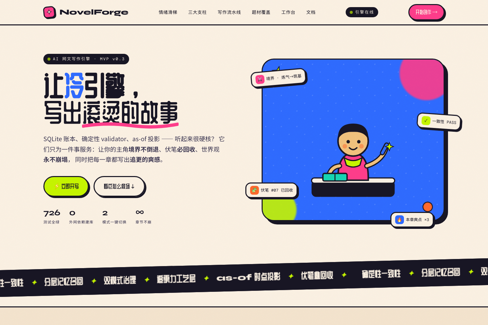
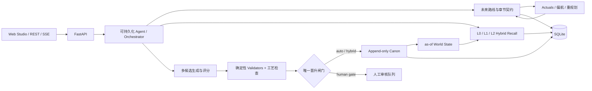

<div align="center">

# NovelForge

### 让 AI 记住长篇故事的每一次选择，并把它写成更好的下一章

面向网文与长篇连载的本地优先 AI 创作引擎：把**分层记忆、确定性一致性、叙事工艺**放进同一条可审计的写作流水线。

[](https://github.com/nasa1024/zi/actions/workflows/ci.yml)


[为什么是 NovelForge](#为什么是-novelforge) · [快速开始](#快速开始) · [系统架构](#系统架构) · [API](#核心-api) · [设计文档](#设计文档)



</div>

## 为什么是 NovelForge

短文本生成只需要“写得像”，长篇连载还必须解决三个彼此独立的问题：**记得住、不能错、还要好看**。NovelForge 不把它们全部交给一次不可解释的模型调用。

| 长篇写作难题 | NovelForge 的处理方式 |
|---|---|
| 角色境界、物品归属、知情关系会漂移 | Canon 只追加账本 + as-of 世界状态投影 + 确定性 Python validators |
| 数十章后的信息无法有效召回 | L0 原文证据、L1 事实原子、L2 场景摘要与实体优先 hybrid recall |
| 模型“没写错”，但章节不好看 | 爽点、钩子、节奏、伏笔回收、value shift 独立评分与修订 |
| 自动写作不可控、失败难恢复 | 可持久化 Agent checkpoint、候选多选一、预算断路器、人工/自动双模式治理 |
| 设定被模型悄悄改写 | LLM 只能提交 `BibleChangeProposal`，唯一晋升闸门决定是否进入 Canon |

### 核心亮点

- **确定性一致性，而非“再问一次 LLM”**：硬状态落入关系表，按章节时点重放；越级、物品冲突、越权知情等问题由可测试规则拦截。
- **可追溯记忆**：从最终事实可以回到候选稿、L0 原文和证据行，支持重建、审计与回滚。
- **写作闭环**：未来章节候选 → 人工或 AI 选择 → 章节契约 → 多候选起草 → 校验与修订 → actuals 提取 → 偏航检测 → 后续重规划。
- **本地优先**：单一 SQLite 加文件系统即可运行；确定性核心和完整界面不依赖外部 API key。
- **供应商可替换**：正文生成支持 DeepSeek、Anthropic 与 OpenAI-compatible 接口，离线开发可使用 Fake provider 和 hash embedding。
- **工程化可恢复**：append-only 计划版本、CAS 正文修订、原子文件写入、热备份、SSE 断线续传与冷启动批处理均已落地。

## 快速开始

### 环境要求

- Python 3.13
- Node.js 20+
- Git

### 1. 启动后端

```bash
git clone https://github.com/nasa1024/zi.git
cd zi

python3.13 -m venv .venv
source .venv/bin/activate
pip install -r requirements.txt

uvicorn novelforge.app.main:app --host 127.0.0.1 --port 8787 --reload
```

打开 [http://127.0.0.1:8787/docs](http://127.0.0.1:8787/docs) 查看交互式 API 文档。健康检查：

```bash
curl http://127.0.0.1:8787/health
```

### 2. 启动 Web Studio

```bash
cd web
npm ci
npm run dev
```

打开 [http://127.0.0.1:5173](http://127.0.0.1:5173)。Vite 会将 `/v1` 请求代理到本地后端，无需额外配置 CORS。

### 3. 不用模型也能体验核心能力

```bash
# 新建项目
curl -s -X POST http://127.0.0.1:8787/v1/projects \
  -H 'Content-Type: application/json' \
  -d '{}'

# 然后在 Studio 中录入设定、查看世界圣经、状态投影、检索和审核队列
```

只有生成正文时才需要外部 LLM；项目管理、Canon、状态投影、检索、审核和记忆健康检查都可离线运行。

## 系统架构



### 一条章节如何生成

1. 从当前章节契约、Canon 世界状态和分层记忆组装稳定上下文。
2. 并行生成多个候选稿，并按契约、情节弧、文气和成本评分。
3. 硬一致性问题直接阻断；软问题进入局部修订，失败时按模型层级升级。
4. 选中稿原子落盘，事实提案进入治理闸门，不允许直接改写 Canon。
5. 从成稿提取 actuals，计算与计划的偏航并按需重规划后续章节。

## 配置 LLM

示例配置文件默认会被 Git 安全保留，真实 `.env` 会被忽略：

```bash
cp .env.example .env
```

DeepSeek 示例：

```ini
NOVELFORGE_PROVIDER=deepseek
DEEPSEEK_API_KEY=your-key-here
```

也可使用：

```ini
NOVELFORGE_PROVIDER=anthropic
ANTHROPIC_API_KEY=your-key-here
```

或通过 `openai_compat` 接入兼容服务。向量召回默认使用离线 HashEmbedder；需要外部 embedding 时再设置 `NOVELFORGE_EMBEDDING_*`。完整配置见 [.env.example](.env.example)。

> `NOVELFORGE_API_KEY` 仅用于保护 NovelForge 自身的 REST API，不是 LLM key。不要把任何真实密钥写进源码、示例、测试或提交信息。

## 已实现能力

| 领域 | 能力 |
|---|---|
| 规划 | 全书/卷/章节路线候选、完整章节契约、append-only 版本、偏航评分与重规划 |
| 生成 | 多候选生成、三级漏斗择优、模型升级、质量门控、局部补丁修订 |
| 一致性 | power / knowledge / item / numeric / presence 等确定性 validators，分支隔离与 as-of 重放 |
| 记忆 | L0 原文、L1 原子证据、L2 场景、章/卷/全书摘要、FTS5 + BM25 + 向量 RRF |
| 治理 | auto / human / hybrid 晋升模式、review queue、冲突检测、revert、审计血缘 |
| 长任务 | Autopilot 挂机连写、SSE 实时进度、取消/恢复、checkpoint 与失败降级 |
| 运维 | Schema v20 增量迁移、热备份、FTS/记忆重建、孤儿与 crashed run 扫描 |
| 交互 | 营销首页、创作 Studio、世界观、规划、审核、设置工作区与 REST API |

## 核心 API

所有业务路由使用 `/v1` 前缀。

| 方法 | 路径 | 用途 |
|---|---|---|
| `POST` | `/projects` | 新建项目 |
| `POST` | `/{pid}/agent/start` | 启动选择式创作 Agent |
| `POST` | `/{pid}/planning/windows/generate` | 生成未来章节路线候选 |
| `POST` | `/{pid}/pipeline/run` | 执行一章完整生成流水线 |
| `GET` | `/{pid}/chapters/{chapter}/alignment` | 查看 actuals、证据和偏航 |
| `POST` | `/{pid}/chapters/{chapter}/replan` | 预览或应用后续重规划 |
| `GET` | `/{pid}/bible` | 确定性渲染世界圣经 |
| `POST` | `/{pid}/state` | 查询指定章节的世界状态 |
| `POST` | `/{pid}/governance/review` | 审批事实提案 |
| `GET` | `/{pid}/memory/health` | 查看记忆覆盖和告警 |
| `POST` | `/{pid}/memory/rebuild` | 重建 FTS、L1、L2 与向量 |
| `POST` | `/{pid}/admin/backup` | 在线热备份 |

完整接口以运行时的 `/docs` 为准。

## 工程质量

```bash
# 后端
.venv/bin/python -m pytest -q
# 726 passed

# 前端：类型、Lint、单测、生产构建
cd web && npm run check
```

后端测试覆盖 Schema 迁移、原子写入、分支隔离、状态重放、规划事务、Agent checkpoint、记忆重建、治理、认证、SSE、Autopilot 和端到端 MVP 流水线。CI 在每次 push 和 pull request 上运行同一套检查。

## 项目结构

```text
novelforge/
├── app/             # FastAPI、REST 路由、Agent runtime
├── control_plane/   # Orchestrator、预算、LLM providers
├── planning/        # 路线、章节契约、actuals、偏航与重规划
├── memory/          # L1/L2、摘要、召回、embedding、维护
├── world/           # 分支、投影、as-of replay
├── validators/      # 确定性一致性规则
├── governance/      # Gate、conflict、commit、revert
├── craft/           # 节奏、钩子、伏笔、文风与候选择优
├── db/              # SQLite schema、迁移与写入
└── skills/          # 规划、起草、检查、抽取 Skill

web/                 # React + TypeScript + Vite Studio
tests/               # 后端自动化测试
docs/NovelForge/     # 架构、数据契约与实现规格
```

## 设计文档

从 [docs/NovelForge/00-总览与阅读指南.md](docs/NovelForge/00-总览与阅读指南.md) 开始。推荐阅读顺序：

- [总体架构](docs/NovelForge/01-总体架构.md)
- [存储与数据模型](docs/NovelForge/02-存储与数据模型.md)
- [Canon 治理与双模式](docs/NovelForge/03-Canon治理与双模式.md)
- [网文工艺层](docs/NovelForge/05-网文工艺层.md)
- [记忆管线与召回](docs/NovelForge/06-记忆管线与召回.md)
- [Agent 循环与工具调用](docs/NovelForge/12-Agent循环与工具调用.md)
- [选择式创作 Agent 与框架选型](docs/NovelForge/21-选择式创作Agent与框架选型.md)

## 安全

- `.env`、本地数据库、L0 草稿、向量索引和备份默认不入库。
- 不要在 issue、日志、截图、测试 fixture 或 commit message 中提交真实凭据。
- 如果密钥曾进入 Git，即使后来删除，也应立即撤销并从完整历史中清除。
- 安全问题请遵循 [SECURITY.md](SECURITY.md)，优先使用 GitHub 的私密漏洞报告渠道。

## 参与贡献

欢迎通过 Issue 描述问题与预期行为，并通过 Pull Request 提交小而可验证的改动。提交前请运行后端测试和 `npm run check`；架构级变更建议同步更新 `docs/NovelForge/` 中的设计文档。

---

<div align="center">

**一致性是不扣分项，追更力才是得分项。**

</div>
