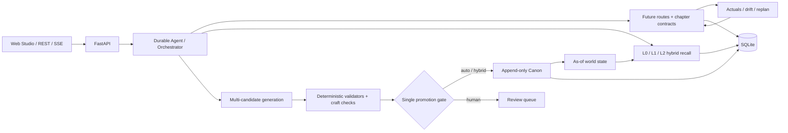

<div align="center">

# zi

### An AI writing engine that remembers every choice—and turns it into a better next chapter

Local-first infrastructure for long-form fiction, combining **hierarchical memory**, **deterministic continuity**, and **narrative craft** in one auditable writing loop.

[](BUILD_WEEK.md)
[](https://github.com/nasa1024/zi/actions/workflows/ci.yml)


[](LICENSE)

[中文](README.zh-CN.md) · [Build Week evidence](BUILD_WEEK.md) · [Quick start](#quick-start) · [Architecture](#architecture) · [Judge testing guide](docs/submission/JUDGE_TESTING.md)


</div>

## The 30-second pitch

Most AI writing tools optimize a single prompt. Long-form fiction is a different systems problem: after dozens of chapters, the model must remember what happened, respect hard world rules, preserve future plans, and still produce a chapter readers want to continue.

zi separates those responsibilities instead of asking one opaque model call to solve everything:

| Long-form failure | zi's response |
|---|---|
| Character powers, possessions, or knowledge drift | Append-only Canon ledger, chapter-time world-state projection, deterministic validators |
| Important events disappear from context | L0 evidence, L1 fact atoms, L2 scenes, entity-first hybrid recall |
| A chapter is consistent but dull | Independent scoring for hooks, pacing, payoff, value shift, and voice |
| Autonomous writing becomes uncontrollable | Durable checkpoints, multi-candidate selection, budget breakers, human/automatic governance |
| The model silently rewrites the world | Models only propose changes; one promotion gate decides what becomes Canon |

The result is an **outline → draft → verify → observe → realign** loop in which every important decision remains inspectable and reversible.

> **Naming note:** the project and submission name is **zi**. The existing Python import path `novelforge`, `NOVELFORGE_*` environment variables, and historical architecture directory are retained for backward compatibility.

## OpenAI Build Week 2026

zi entered Build Week as an existing project and was meaningfully extended during the submission period with Codex and GPT-5.6. The Build Week release closes the outline-driven writing loop across the backend, database, tests, and product UI.

### What was added during Build Week

- A unified planning service for whole-book, volume, and chapter decisions.
- Complete, versioned chapter contracts instead of loose prompt hints.
- Final-draft `actuals` extraction with evidence spans.
- Weighted drift scoring between the plan and the finished chapter.
- Transactional future-window replanning that never mutates Canon.
- Runtime capability negotiation and graceful model fallback.
- A full writing workspace for contracts, candidates, alignment evidence, plan versions, and replan previews.
- 1,500+ lines of focused planning and API tests inside the larger 726-test suite.

| Evidence | Value |
|---|---|
| Build Week commit | [`f8761e6`](https://github.com/nasa1024/zi/commit/f8761e69e16f2525f5c62dd404b45200c3487b34) |
| Commit time | July 16, 2026, 01:54 CST / July 15, 2026, 10:54 PDT |
| Functional delta | 70 files; 11,669 additions; 765 deletions |
| Codex model | `gpt-5.6-sol` |
| Core Codex session | `019f664f-c328-7453-8550-f664e6eead64` |
| Track | Apps for Your Life |

The exact pre-existing/new-work boundary, human decisions, Codex contributions, and commit-SHA mapping are documented in [BUILD_WEEK.md](BUILD_WEEK.md).

## Why it is different

- **Deterministic continuity, not another LLM opinion.** Hard state lives in relational tables and is replayed as of a chapter. Rule violations such as impossible power progression, knowledge without presence, or conflicting item ownership are testable code paths.
- **Memory with provenance.** A promoted fact can be traced back through its candidate, final draft, L0 source, and evidence lines. Derived memory can be rebuilt without rewriting Canon.
- **Plans are hypotheses, not facts.** Future chapter plans are append-only versions. The finished prose produces actuals; drift is measured; only future plans are revised.
- **Local-first by default.** SQLite and the filesystem are enough for the deterministic core and complete UI. External model keys are only needed for live generation.
- **Models are replaceable.** The runtime supports DeepSeek, Anthropic, OpenAI-compatible services, a deterministic fake provider, and offline hash embeddings.
- **Failure is recoverable.** Atomic draft writes, CAS revisions, durable agent checkpoints, hot backups, SSE replay, and circuit breakers are built in.

## Quick start

### Requirements

- Python 3.13
- Node.js 20+
- Git

### 1. Start the API

```bash
git clone https://github.com/nasa1024/zi.git
cd zi

python3.13 -m venv .venv
source .venv/bin/activate
pip install -r requirements.txt

uvicorn novelforge.app.main:app --host 127.0.0.1 --port 8787 --reload
```

Open [http://127.0.0.1:8787/docs](http://127.0.0.1:8787/docs) for interactive API documentation. Verify the service with:

```bash
curl http://127.0.0.1:8787/health
```

### 2. Start the Studio

```bash
cd web
npm ci
npm run dev
```

Open [http://127.0.0.1:5173](http://127.0.0.1:5173). Vite proxies `/v1` calls to the local API.

### 3. Try the deterministic core without an API key

```bash
curl -s -X POST http://127.0.0.1:8787/v1/projects \
  -H 'Content-Type: application/json' \
  -d '{}'
```

Then use the Studio to load sample world rules, inspect the rendered World Bible, query world state, search facts, review proposals, and explore the planning workspace. Project management, Canon, projections, review, search, and memory health work offline. Live prose generation is the only path that requires an external LLM.

For a focused evaluation path, see the [judge testing guide](docs/submission/JUDGE_TESTING.md).

## Architecture



### The chapter loop

1. Assemble a stable context from the current contract, as-of Canon state, and layered memory.
2. Generate multiple candidates and score contract adherence, arc progress, prose quality, and cost.
3. Block hard continuity failures; locally revise soft failures; escalate model capability when needed.
4. Atomically save the selected draft. Fact proposals enter governance and cannot directly mutate Canon.
5. Extract evidence-backed actuals from the final draft, score drift, and optionally replan future chapters.

## Implemented capabilities

| Area | Capabilities |
|---|---|
| Planning | Book/volume/chapter route candidates, full contracts, append-only versions, drift scoring, replanning |
| Generation | Multi-candidate drafting, funnel selection, model escalation, quality gates, anchored patch revision |
| Continuity | Power, knowledge, item, numeric, presence validators; branch isolation; as-of replay |
| Memory | L0 evidence, L1 atoms, L2 scenes, chapter/volume/book summaries, FTS5 + BM25 + vector RRF |
| Governance | Auto/human/hybrid promotion, review queue, conflicts, revert, provenance |
| Long tasks | Autopilot, live SSE progress, cancel/resume, checkpoints, automatic degradation |
| Operations | Schema v20 migrations, hot backups, memory/FTS rebuilds, orphan and crashed-run recovery |
| Product | Landing page, writing, planning, world, review, and settings workspaces plus REST API |

## Configure a live model

Copy the placeholder-only environment template:

```bash
cp .env.example .env
```

Example:

```ini
NOVELFORGE_PROVIDER=deepseek
DEEPSEEK_API_KEY=your-key-here
```

Anthropic and OpenAI-compatible endpoints are also supported. Vector recall uses the offline `HashEmbedder` by default; external embeddings are opt-in through `NOVELFORGE_EMBEDDING_*`. See [.env.example](.env.example) for every setting.

> `NOVELFORGE_API_KEY` is the compatibility name for the variable that protects zi's own REST API. It is not an LLM credential. Never place a real key in source, examples, fixtures, logs, screenshots, or commit messages.

## Core API

All business routes use the `/v1` prefix.

| Method | Path | Purpose |
|---|---|---|
| `POST` | `/projects` | Create a project |
| `POST` | `/{pid}/agent/start` | Start the choice-driven creation agent |
| `POST` | `/{pid}/planning/windows/generate` | Generate future route candidates |
| `POST` | `/{pid}/pipeline/run` | Run the full chapter pipeline |
| `GET` | `/{pid}/chapters/{chapter}/alignment` | Inspect actuals, evidence, and drift |
| `POST` | `/{pid}/chapters/{chapter}/replan` | Preview or apply a future replan |
| `GET` | `/{pid}/bible` | Deterministically render the World Bible |
| `POST` | `/{pid}/state` | Query world state at a chapter |
| `POST` | `/{pid}/governance/review` | Review a fact proposal |
| `GET` | `/{pid}/memory/health` | Inspect memory coverage and alerts |
| `POST` | `/{pid}/memory/rebuild` | Rebuild FTS, L1, L2, and vectors |
| `POST` | `/{pid}/admin/backup` | Create an online backup |

The running `/docs` endpoint is the source of truth for the complete API.

## Engineering quality

```bash
# Backend
.venv/bin/python -m pytest -q
# 726 passed

# Frontend: types, lint, unit tests, production build
cd web && npm run check
```

The suite covers migrations, atomic writes, branch isolation, state replay, planning transactions, agent checkpoints, memory rebuilds, governance, authentication, SSE, Autopilot, and end-to-end pipelines. GitHub Actions runs the same backend and frontend checks on pushes and pull requests.

## Repository map

```text
novelforge/           # Internal Python package name retained for compatibility
├── app/             # FastAPI, REST routes, agent runtime
├── control_plane/   # Orchestrator, budgets, LLM providers
├── planning/        # Routes, contracts, actuals, drift, replan
├── memory/          # L1/L2, summaries, recall, embeddings
├── world/           # Branches, projections, as-of replay
├── validators/      # Deterministic continuity rules
├── governance/      # Gate, conflict, commit, revert
├── craft/           # Pacing, hooks, payoff, voice, judging
├── db/              # SQLite schema, migrations, writes
└── skills/          # Planning, drafting, checking, extraction

web/                 # React + TypeScript + Vite Studio
tests/               # Backend automated tests
docs/NovelForge/     # Architecture and implementation specs
docs/submission/     # Build Week submission materials
```

## Documentation

Start with [docs/NovelForge/00-总览与阅读指南.md](docs/NovelForge/00-总览与阅读指南.md). Deeper references include the [architecture](docs/NovelForge/01-总体架构.md), [data model](docs/NovelForge/02-存储与数据模型.md), [Canon governance](docs/NovelForge/03-Canon治理与双模式.md), [craft layer](docs/NovelForge/05-网文工艺层.md), [memory pipeline](docs/NovelForge/06-记忆管线与召回.md), and [agent design](docs/NovelForge/21-选择式创作Agent与框架选型.md).

## Security and license

Local `.env` files, databases, drafts, vector indexes, and backups are ignored by Git. Report vulnerabilities according to [SECURITY.md](SECURITY.md). zi is released under the [MIT License](LICENSE).

---

<div align="center">

**Consistency prevents disappointment. Narrative momentum earns the next chapter.**

</div>
