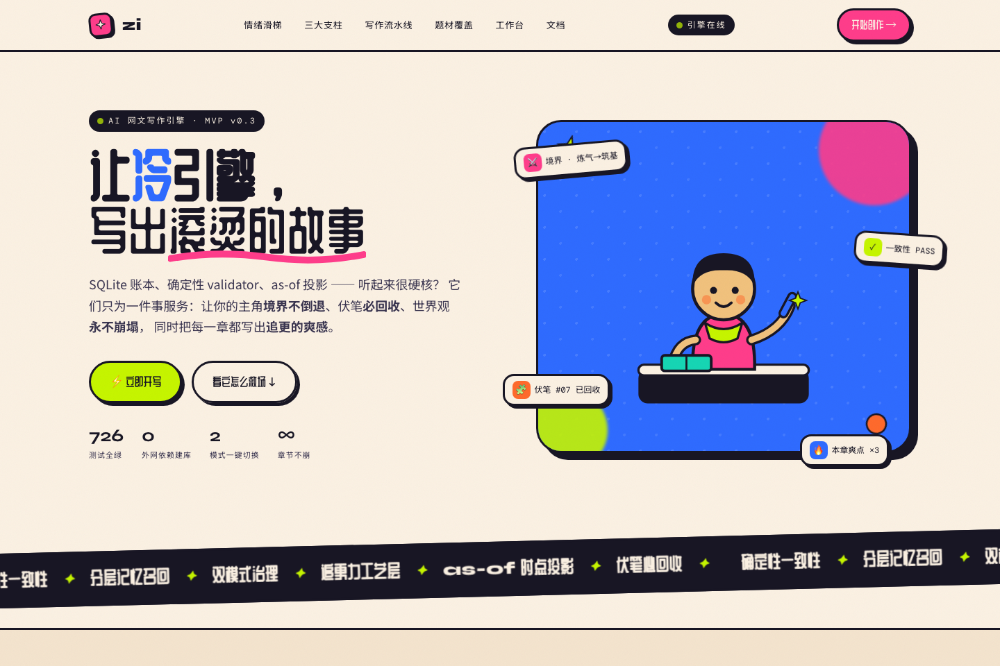

# zi 中文说明

[English README](README.md) · [Build Week 证据](BUILD_WEEK.md) · [评委测试指南](docs/submission/JUDGE_TESTING.md)

zi 是面向网文与长篇连载的本地优先 AI 创作引擎，把**分层记忆、确定性一致性、叙事工艺**放进同一条可审计的写作流水线。

> 项目和参赛名称统一为 **zi**。现有 Python 包名 `novelforge`、`NOVELFORGE_*` 环境变量和历史架构文档目录仅为兼容性保留。



## 核心思路

- 软记忆走检索，角色境界、物品、知情关系等硬状态进入关系表和确定性校验器。
- Canon 是只追加账本；模型只能提交提案，不能直接改写世界设定。
- 未来大纲是可版本化的假设，不是既成事实；正文完成后提取 actuals、计算偏航并重规划未来章节。
- 爽点、钩子、节奏、伏笔和文风由独立工艺层评估。
- SQLite + 本地文件系统即可运行确定性核心，只有正文生成需要外部模型。

## Build Week 新增能力

项目在 OpenAI Build Week 前已经具备 Canon、记忆、一致性和基础生成能力。7 月 15–16 日使用 Codex `gpt-5.6-sol` 完成了大纲驱动闭环：

- 统一全书、卷、章节规划服务；
- 完整章节契约及 append-only 版本；
- 成稿 actuals 与证据提取；
- 加权偏航评分和未来窗口重规划；
- 合同、候选稿、偏航证据和计划版本的完整 Studio 界面；
- 新增规划、API、运行时和前端测试。

对应提交为 `f8761e6`，核心 Codex Session ID 为 `019f664f-c328-7453-8550-f664e6eead64`。完整边界和证据见 [BUILD_WEEK.md](BUILD_WEEK.md)。

## 快速开始

需要 Python 3.13 和 Node.js 20+。

```bash
git clone https://github.com/nasa1024/zi.git
cd zi
python3.13 -m venv .venv
source .venv/bin/activate
pip install -r requirements.txt
uvicorn novelforge.app.main:app --host 127.0.0.1 --port 8787 --reload
```

另开终端：

```bash
cd zi/web
npm ci
npm run dev
```

打开 <http://127.0.0.1:5173>。无需模型 key 即可体验项目、世界圣经、状态投影、检索、审核、记忆健康和规划界面。

## 接入模型（默认 Gemini 4）

```bash
export NOVELFORGE_PROVIDER=gemini
export GEMINI_API_KEY=你的key   # Google AI Studio 付费层
```

- 底层模型为 `gemini-4-argon`：输入输出共享 1,048,576 token，单次请求超过 64K 输出时自动续接（long decode）。
- 三档（fast/mid/strong）同为 Gemini 4，以思考强度 low/medium/high 区分；可用 `NOVELFORGE_STRONG_MODEL=gemini-4-argon@medium` 等覆盖。
- 长输出能力用于卷规划：单次由 ≤10 章放宽到 ≤30 章。
- 仍支持 DeepSeek / Anthropic / OpenAI 兼容端点，详见 [.env.example](.env.example) 与 [Gemini 4 接入说明](docs/NovelForge/22-Gemini4接入与长输出改造.md)。

## 验证

```bash
.venv/bin/python -m pytest -q  # 726 passed
cd web && npm run check
```

完整英文产品、架构、API、配置与安全说明请阅读 [README.md](README.md)。项目采用 [MIT License](LICENSE)。
