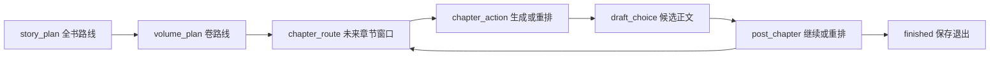

# 21. 选择式创作 Agent 与框架选型

## 21.1 产品目标

NovelForge 的主要交互不再要求作者先填写一整套背景、人物和故事线表单，而是：

1. Agent 根据已有设定或零输入生成 3 个可比较的全书方向；
2. 作者选择一个方案，或点击“让 AI 决定”；
3. Agent 继续生成卷方案与未来 3–10 章滚动路线；
4. 选择后的章节路线成为锁定创作契约；
5. 正文生成同时读取历史 canon 与未来计划，但二者物理分离；
6. 每个决策点都可暂停、恢复、在提交前换一批方案，并可审计。已提交的历史决策不就地改写；后续调整通过新的 replan 决策留痕完成。

这是一条**阶段明确、状态有限、必须可恢复的人机协作工作流**，而不是一个可以自由调用大量工具、自己拆解任意任务的通用自治 Agent。

---

## 21.2 LangGraph 与 Deep Agents 对比

Deep Agents 建立在 LangGraph 之上，重点提供 todo 规划、文件系统、子 Agent、长任务上下文管理和工具调用审批等通用自治能力。两者不是同一层级的完全替代品。

| 维度 | LangGraph | Deep Agents | NovelForge 需要 |
|---|---|---|---|
| 核心抽象 | 显式状态图、节点、边、interrupt/resume | 开放式任务规划、todo、工具与子 Agent | 显式创作阶段 |
| 人机协作 | 可在任意业务节点 `interrupt()`，用 `Command(resume=...)` 恢复 | 更偏工具调用前审批和通用 HITL | 每一步展示业务选项 |
| 可恢复性 | `thread_id` + checkpointer 精确恢复图状态 | 继承 LangGraph 的持久化能力 | 必须支持页面关闭后恢复 |
| 业务状态 | 可只保存控制流，把领域数据留在现有数据库 | 倾向把更多工作上下文交给 Agent runtime | NovelForge SQLite 必须是权威 |
| 自主规划 | 由产品显式定义阶段，行为可预测 | Agent 自己拆任务、写 todo、调用工具 | 主流程不需要自由拆解 |
| 多 Agent | 可按需组合，但不强制 | 子 Agent 是核心能力之一 | 当前会增加成本和调试复杂度 |
| 典型用途 | 审批流、客服流、创作向导、确定性工作流 | 研究、编码、资料整理、开放式长任务 | 前者为主，后者为可选扩展 |

### 结论

**核心运行时选择 LangGraph。**

原因不是 Deep Agents 能力不足，而是它的默认能力集合大于当前产品问题。NovelForge 的关键价值是“作者始终知道现在在决定什么、选择会影响哪里、之后能否恢复”，显式状态图比开放式 todo/子 Agent 更容易保证：

- 决策点稳定；
- 成本上限明确；
- 不会在后台无限循环；
- 每一步都可审计；
- 未来计划不会误写成已发生事实；
- 前端能直接渲染业务状态，而不必解释自由文本执行轨迹。

**Deep Agents 保留为后续可选模块，不作为主创作循环。** 适合的扩展位置包括：

- 为历史/科幻题材做资料研究并返回引用包；
- 并行探索若干完全不同的长线分支；
- 从资料目录整理世界观候选；
- 让独立“研究员”或“分支策划”子 Agent 产出候选，再交回 LangGraph 决策节点。

这些模块只能产出提案或选项，不能绕过 NovelForge 的决策表、Canon Gate 或 World State。

---

## 21.3 当前运行时结构

主图采用以下阶段：



实现要点：

- `StateGraph` 管理阶段与转移；
- `interrupt()` 把结构化 `decision_set` 返回前端；
- `Command(resume=...)` 接收人工选择、AI 代选或 reroll；
- `thread_id=session_id` 绑定可恢复 checkpoint；
- `durability="sync"` 在进入下一节点前同步持久化 checkpoint；
- `SqliteSaver` 只保存 LangGraph 控制流状态；
- `sessions` / `turns` / `turn_events` 保存交互审计；
- `decision_sets` / `decision_options` 保存选择与推荐；
- `story_plans` / `story_arcs` / `arc_milestones` 保存长期计划；
- `chapter_cards` / `beats` 保存已选择的滚动章节契约。

LangGraph 的 checkpoint 不会自动让外部数据库写入幂等。v17 因此给卷计划增加
`source_decision_id`，并在决策、全书计划、卷计划和章节路线写入前复用同一来源的
既有记录；节点重放不会重复创建业务对象。旧 v16 项目在首次打开时自动迁移。

LangGraph checkpoint 不是领域真相源。即使更换 Agent runtime，NovelForge 的选择、计划、正文和 canon 仍可从项目 SQLite 独立读取。

---

## 21.4 “看前文”与“看未来”的双通道

章节 N 的生成上下文必须同时包含两类信息，但不能混在一起：

| 通道 | 时间语义 | 来源 | 用途 |
|---|---|---|---|
| Historical Context | `as_of=N-1`，已经发生 | canon、World State、历史摘要与召回 | 防止人物、力量、知情关系等前后矛盾 |
| Plan Context | N 章及以后，作者意图 | 全书路线、情节弧、里程碑、未来章节卡 | 铺垫、控制节奏、防止提前揭底 |

硬规则：

- Future Plan 永远不能进入 canon 或 World State；
- 当前章存在锁定 beats 时，Planner 不得静默重新规划；
- Draft 只接收压缩后的未来护栏，不把未来事件描述成已经发生；
- `not_before_chapter` 之前命中明确里程碑关键词，产生 `PREMATURE_PLAN_REVEAL` block；
- 章末对里程碑做完成、延期和偏航对账，必要时提示 replan。
- 重新规划未来路线时，同时注入严格截至 `N-1` 的 canon、全书/卷摘要和近期章节摘要；模型不能用未来计划覆盖已经发生的正文。

这解决了旧流程“只看前边，不看之后故事发展”的问题，同时不破坏原有严格 `as_of` 语义。

---

## 21.5 两组模式必须分开

交互自主程度与 canon 治理不是同一个开关：

### 交互模式 `interaction_mode`

- `guided`：每个决策节点等待作者选择；
- `copilot`：仍等待作者，但突出模型推荐和“一键让 AI 决定”；
- `autonomous`：模型自动选项，达到 `auto_chapters` 上限后保存退出。

### Canon 治理 `governance_mode`

- `human_gate`；
- `hybrid`；
- `auto_promote`。

例如，作者可以选择 `autonomous + human_gate`：Agent 自动规划和写章，但新 canon 事实仍进入人工审核队列。不能因为交互自动化而隐式放宽 canon 权限。

---

## 21.6 API 与前端

Agent API：

| 方法 | 路径 | 说明 |
|---|---|---|
| POST | `/{project_id}/agent/start` | 创建会话并运行到第一个选择点 |
| GET | `/{project_id}/agent/sessions` | 列出可恢复会话 |
| GET | `/{project_id}/agent/{session_id}` | 从 checkpoint 读取当前状态 |
| POST | `/{project_id}/agent/{session_id}/choose` | select / auto / reroll |
| GET | `/{project_id}/story-map` | 读取全书路线、情节弧、里程碑和未来章节卡 |

Studio 的首个标签为“创作 Agent”，提供：

- 逐步选择 / 协作 / 模型决定三种模式；
- 三张业务选项卡及推荐理由、影响范围；
- “让 AI 决定”和“换一批方案”；AI 代选由 FAST-tier 结构化裁判真正比较候选，并展示选择理由；无模型或输出无效时按评分确定性降级；
- checkpoint 会话恢复；
- 全书路线、卷、情节弧、里程碑和未来章节时间线；
- 传统设定表单、审核队列和手动 pipeline 作为高级模式继续保留。

新建项目允许完全零输入。书名留空时后端生成题材相关工作名，创建后直接进入 Agent 路线选择。

---

## 21.7 依赖与验证

```bash
pip install -r requirements.txt

# 离线验证，不需要模型 key
NOVELFORGE_PROVIDER=fake .venv/bin/python -m pytest -q tests/test_agent_v16.py

# 全量后端与前端
.venv/bin/python -m pytest -q
cd web && npm run build
```

关键依赖：

- `langgraph==1.0.8`
- `langgraph-checkpoint-sqlite==3.1.0`

生产环境仍应给每次自主运行设置章节上限、token/USD 预算、超时和错误熔断。Deep Agents 若后续接入，也必须遵守同一组限制。

---

## 21.8 2026-07-11 Context7 文档核对

- LangGraph 官方包 `/langchain-ai/langgraph/1.0.8`：确认 `thread_id` 是 checkpointer 必需配置，`StateGraph` 支持条件边、持久化、`interrupt()` 人机暂停以及 `Command(resume=...)` 恢复；当前安装版本的 `invoke/stream` 均支持 `durability` 参数。
- Deep Agents 官方包 `/langchain-ai/deepagents`：定位仍是通用复杂任务架构，核心能力为 planning tools、上下文文件系统、子 Agent 和详细提示模板。

因此“使用流行 Agent 框架优化”在本项目中的落地方式是：用 LangGraph 承担唯一主运行时，并吸收 Deep Agents 的任务分解/子 Agent 思路作为未来可插拔研究能力；不在同一条创作主链中叠加多个 runtime，避免重复 checkpoint、状态所有权冲突和难以审计的嵌套循环。
